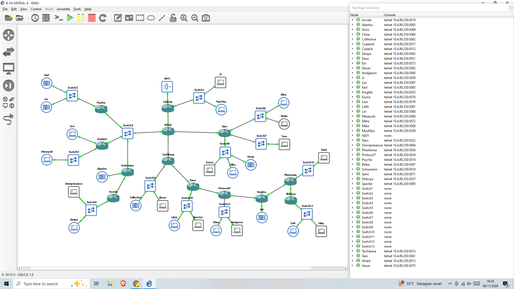
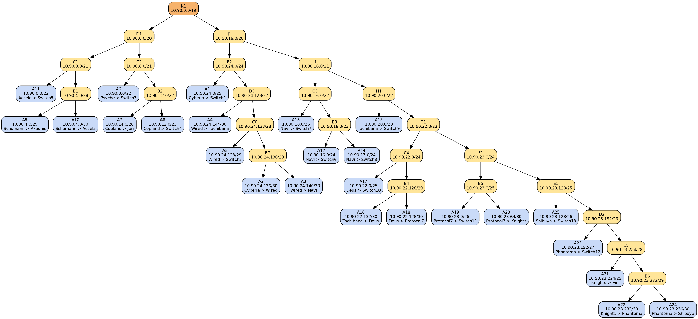
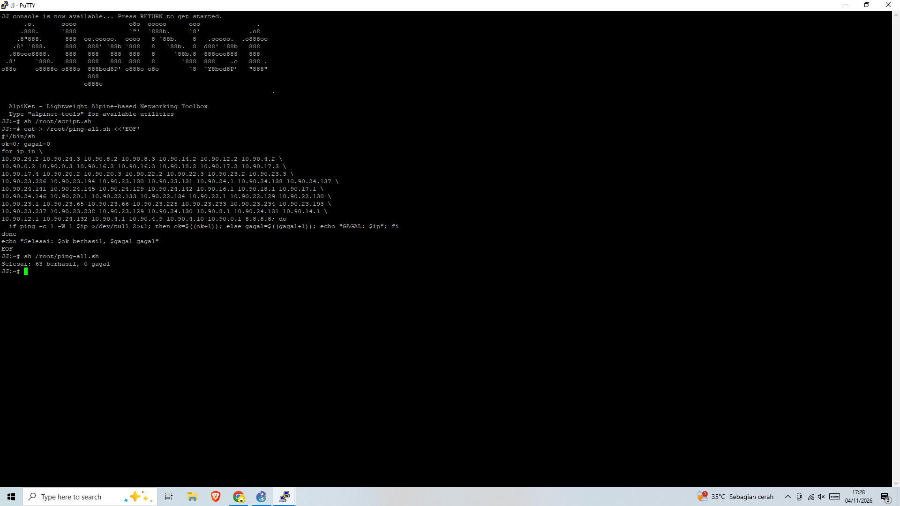
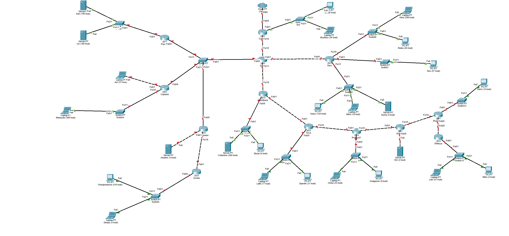

# Laporan Resmi Praktikum Modul 4 — Komunikasi Data & Jaringan Komputer 2026

## Serial Experiments Lain — Layer:04 — The Wired Expansion

| | |
|---|---|
| **Kelompok** | K-53 |
| **Server GNS3** | Group C — `10.4.89.250` |
| **Prefix IP** | `10.90.x.x` |
| **Anggota (bagian CIDR + GNS3)** | Annabel Clarissa — NRP 5027251016 |
| **Anggota (bagian VLSM + Cisco Packet Tracer)** | Nayla Aisha Hanifa (5027251075) |

Repositori ini memuat laporan **bagian GNS3 dengan metode CIDR**. Bagian Cisco Packet Tracer (metode VLSM) dikerjakan anggota kelompok yang lain, sesuai ketentuan soal bahwa kedua tools memakai metode classless yang berbeda.

## Daftar Isi
1. [Ringkasan](#1-ringkasan)
2. [Lingkungan dan Tools](#2-lingkungan-dan-tools)
3. [Topologi dan Urutan Kabel](#3-topologi-dan-urutan-kabel)
4. [Perhitungan IP dengan CIDR](#4-perhitungan-ip-dengan-cidr)
5. [Routing](#5-routing)
6. [Konfigurasi Node](#6-konfigurasi-node)
7. [Pengujian](#7-pengujian)
8. [Penjelasan Metode CIDR](#8-penjelasan-metode-cidr)
9. [Struktur Repositori](#9-struktur-repositori)

## 1. Ringkasan

Topologi The Wired terdiri dari 13 router, 13 switch, 25 node host, dan 1 node NAT. Hanya router **Cyberia** yang terhubung ke NAT; seluruh lalu lintas ke luar mengalir melalui **Wired**, hub yang bercabang ke Navi, Tachibana, dan satu segmen bersama milik Psyche, Copland, dan Schumann.

Tujuan: membagi alamat IP dan menyusun routing **seefisien mungkin** sehingga tidak ada alamat yang terbuang dan semua node dapat saling melakukan `ping`.

Hasil utama:

- 25 subnet (A1–A25) digabung dengan metode CIDR menjadi satu blok **10.90.0.0/19** (`K1`).
- Setiap router hanya memerlukan **satu default route** dan **paling banyak satu route supernet per arah hilir** (Wired: lima route supernet).
- Seluruh node berhasil saling `ping`, termasuk ke internet melalui NAT.

## 2. Lingkungan dan Tools

| Komponen | Keterangan |
|---|---|
| GNS3 | Client 3.0.6 terhubung ke server remote `10.4.89.250` (Group C), project `K-53-MODUL-4` |
| Image Docker | `ardhptr21/alpinet:latest` untuk seluruh router dan host |
| Switch | Ethernet switch bawaan GNS3 (13 buah) |
| Akses internet | Node NAT GNS3 yang terhubung ke Cyberia |
| Lokasi script | `/root/script.sh` pada setiap node |

## 3. Topologi dan Urutan Kabel



Script memanggil interface dengan nama `ethN`, sehingga urutan adapter pada router harus sesuai tabel berikut:

| Router | Interface | Alamat | Terhubung ke |
|---|---|---|---|
| Cyberia | eth0 | DHCP (NAT) | NAT1 |
| Cyberia | eth1 | `10.90.24.1/25` | Switch1 |
| Cyberia | eth2 | `10.90.24.138/30` | Wired |
| Wired | eth0 | `10.90.24.137/30` | Cyberia |
| Wired | eth1 | `10.90.24.141/30` | Navi |
| Wired | eth2 | `10.90.24.145/30` | Tachibana |
| Wired | eth3 | `10.90.24.129/29` | Switch2 |
| Navi | eth0 | `10.90.24.142/30` | Wired |
| Navi | eth1 | `10.90.16.1/24` | Switch6 |
| Navi | eth2 | `10.90.18.1/26` | Switch7 |
| Navi | eth3 | `10.90.17.1/24` | Switch8 |
| Tachibana | eth0 | `10.90.24.146/30` | Wired |
| Tachibana | eth1 | `10.90.20.1/23` | Switch9 |
| Tachibana | eth2 | `10.90.22.133/30` | Deus |
| Deus | eth0 | `10.90.22.134/30` | Tachibana |
| Deus | eth1 | `10.90.22.1/25` | Switch10 |
| Deus | eth2 | `10.90.22.129/30` | Protocol7 |
| Protocol7 | eth0 | `10.90.22.130/30` | Deus |
| Protocol7 | eth1 | `10.90.23.1/26` | Switch11 |
| Protocol7 | eth2 | `10.90.23.65/30` | Knights |
| Knights | eth0 | `10.90.23.66/30` | Protocol7 |
| Knights | eth1 | `10.90.23.225/29` | Eiri |
| Knights | eth2 | `10.90.23.233/30` | Phantoma |
| Phantoma | eth0 | `10.90.23.234/30` | Knights |
| Phantoma | eth1 | `10.90.23.193/27` | Switch12 |
| Phantoma | eth2 | `10.90.23.237/30` | Shibuya |
| Shibuya | eth0 | `10.90.23.238/30` | Phantoma |
| Shibuya | eth1 | `10.90.23.129/26` | Switch13 |
| Psyche | eth0 | `10.90.24.130/29` | Switch2 |
| Psyche | eth1 | `10.90.8.1/22` | Switch3 |
| Copland | eth0 | `10.90.24.131/29` | Switch2 |
| Copland | eth1 | `10.90.14.1/26` | Juri |
| Copland | eth2 | `10.90.12.1/23` | Switch4 |
| Schumann | eth0 | `10.90.24.132/29` | Switch2 |
| Schumann | eth1 | `10.90.4.1/29` | Akashic |
| Schumann | eth2 | `10.90.4.9/30` | Accela |
| Accela | eth0 | `10.90.4.10/30` | Schumann |
| Accela | eth1 | `10.90.0.1/22` | Switch5 |

Host tersambung ke switch lewat `eth0`. Tiga host terhubung **langsung** ke router tanpa switch: Juri (Copland), Akashic (Schumann), dan Eiri (Knights).

## 4. Perhitungan IP dengan CIDR

### 4.1 Aturan perhitungan

1. **Jumlah IP** setiap subnet = jumlah host + jumlah interface router pada subnet tersebut.
2. Ditambah 2 alamat (network dan broadcast), lalu dibulatkan ke pangkat dua terdekat untuk mendapat netmask.
3. Subnet digabung **berpasangan dari bawah ke atas** mengikuti topologi. Hasil gabungan dua subnet adalah blok yang satu bit lebih pendek dari subnet terbesar di antara keduanya (contoh `/30` + `/26` menjadi `/25`).
4. Alamat jaringan hasil gabungan ditentukan dari atas ke bawah sehingga semua blok berada tepat pada batas pangkat dua (aligned) dan tidak saling tumpang tindih.

### 4.2 Kebutuhan IP tiap subnet (sheet Rute)

| Subnet | Rute | Jumlah IP | Netmask |
|---|---|---|---|
| A1 | Cyberia > Switch1 > JJ, MyuMyu | 126 | /25 |
| A2 | Cyberia > Wired | 2 | /30 |
| A3 | Wired > Navi | 2 | /30 |
| A4 | Wired > Tachibana | 2 | /30 |
| A5 | Wired > Switch2 > Psyche, Copland, Schumann | 4 | /29 |
| A6 | Psyche > Switch3 > Karl, Lin | 881 | /22 |
| A7 | Copland > Juri | 32 | /26 |
| A8 | Copland > Switch4 > Masayuki | 301 | /23 |
| A9 | Schumann > Akashic | 4 | /29 |
| A10 | Schumann > Accela | 2 | /30 |
| A11 | Accela > Switch5 > Omnipresence, Denpa | 514 | /22 |
| A12 | Navi > Switch6 > Alice, Reika | 254 | /24 |
| A13 | Navi > Switch7 > Taro | 58 | /26 |
| A14 | Navi > Switch8 > Yasuo, Miho, Kuma | 143 | /24 |
| A15 | Tachibana > Switch9 > Collective, Ghost | 267 | /23 |
| A16 | Tachibana > Deus | 2 | /30 |
| A17 | Deus > Switch10 > Lilith, Specter | 99 | /25 |
| A18 | Deus > Protocol7 | 2 | /30 |
| A19 | Protocol7 > Switch11 > Chisa, Hodgeson | 33 | /26 |
| A20 | Protocol7 > Knights | 2 | /30 |
| A21 | Knights > Eiri | 3 | /29 |
| A22 | Knights > Phantoma | 2 | /30 |
| A23 | Phantoma > Switch12 > Semi | 15 | /27 |
| A24 | Phantoma > Shibuya | 2 | /30 |
| A25 | Shibuya > Switch13 > Lain, Mika | 62 | /26 |
| **Total** | | **2814** | **/19** |

### 4.3 Penggabungan (sheet Penggabungan - CIDR)

**Tahap I**

| Subnet | Gabungan 1 | Mask | Gabungan 2 | Mask | Hasil | Network |
|---|---|---|---|---|---|---|
| B1 | A10 | /30 | A9 | /29 | /28 | `10.90.4.0/28` |
| B2 | A7 | /26 | A8 | /23 | /22 | `10.90.12.0/22` |
| B3 | A12 | /24 | A14 | /24 | /23 | `10.90.16.0/23` |
| B4 | A16 | /30 | A18 | /30 | /29 | `10.90.22.128/29` |
| B5 | A20 | /30 | A19 | /26 | /25 | `10.90.23.0/25` |
| B6 | A22 | /30 | A24 | /30 | /29 | `10.90.23.232/29` |
| B7 | A2 | /30 | A3 | /30 | /29 | `10.90.24.136/29` |

**Tahap II**

| Subnet | Gabungan 1 | Mask | Gabungan 2 | Mask | Hasil | Network |
|---|---|---|---|---|---|---|
| C1 | B1 | /28 | A11 | /22 | /21 | `10.90.0.0/21` |
| C2 | A6 | /22 | B2 | /22 | /21 | `10.90.8.0/21` |
| C3 | A13 | /26 | B3 | /23 | /22 | `10.90.16.0/22` |
| C4 | B4 | /29 | A17 | /25 | /24 | `10.90.22.0/24` |
| C5 | A21 | /29 | B6 | /29 | /28 | `10.90.23.224/28` |
| C6 | A5 | /29 | B7 | /29 | /28 | `10.90.24.128/28` |

**Tahap III**

| Subnet | Gabungan 1 | Mask | Gabungan 2 | Mask | Hasil | Network |
|---|---|---|---|---|---|---|
| D1 | C1 | /21 | C2 | /21 | /20 | `10.90.0.0/20` |
| D2 | C5 | /28 | A23 | /27 | /26 | `10.90.23.192/26` |
| D3 | A4 | /30 | C6 | /28 | /27 | `10.90.24.128/27` |

**Tahap IV**

| Subnet | Gabungan 1 | Mask | Gabungan 2 | Mask | Hasil | Network |
|---|---|---|---|---|---|---|
| E1 | A25 | /26 | D2 | /26 | /25 | `10.90.23.128/25` |
| E2 | D3 | /27 | A1 | /25 | /24 | `10.90.24.0/24` |

**Tahap V**

| Subnet | Gabungan 1 | Mask | Gabungan 2 | Mask | Hasil | Network |
|---|---|---|---|---|---|---|
| F1 | B5 | /25 | E1 | /25 | /24 | `10.90.23.0/24` |

**Tahap VI**

| Subnet | Gabungan 1 | Mask | Gabungan 2 | Mask | Hasil | Network |
|---|---|---|---|---|---|---|
| G1 | C4 | /24 | F1 | /24 | /23 | `10.90.22.0/23` |

**Tahap VII**

| Subnet | Gabungan 1 | Mask | Gabungan 2 | Mask | Hasil | Network |
|---|---|---|---|---|---|---|
| H1 | A15 | /23 | G1 | /23 | /22 | `10.90.20.0/22` |

**Tahap VIII**

| Subnet | Gabungan 1 | Mask | Gabungan 2 | Mask | Hasil | Network |
|---|---|---|---|---|---|---|
| I1 | C3 | /22 | H1 | /22 | /21 | `10.90.16.0/21` |

**Tahap IX**

| Subnet | Gabungan 1 | Mask | Gabungan 2 | Mask | Hasil | Network |
|---|---|---|---|---|---|---|
| J1 | E2 | /24 | I1 | /21 | /20 | `10.90.16.0/20` |

**Tahap X**

| Subnet | Gabungan 1 | Mask | Gabungan 2 | Mask | Hasil | Network |
|---|---|---|---|---|---|---|
| K1 | D1 | /20 | J1 | /20 | /19 | `10.90.0.0/19` |

### 4.4 Pohon pembagian IP



### 4.5 Hasil pembagian (sheet Pembagian IP - CIDR)

| Subnet | Network ID | Netmask | Broadcast | Range IP |
|---|---|---|---|---|
| A1 | `10.90.24.0` | `255.255.255.128` | `10.90.24.127` | `10.90.24.1 - 10.90.24.126` |
| A2 | `10.90.24.136` | `255.255.255.252` | `10.90.24.139` | `10.90.24.137 - 10.90.24.138` |
| A3 | `10.90.24.140` | `255.255.255.252` | `10.90.24.143` | `10.90.24.141 - 10.90.24.142` |
| A4 | `10.90.24.144` | `255.255.255.252` | `10.90.24.147` | `10.90.24.145 - 10.90.24.146` |
| A5 | `10.90.24.128` | `255.255.255.248` | `10.90.24.135` | `10.90.24.129 - 10.90.24.134` |
| A6 | `10.90.8.0` | `255.255.252.0` | `10.90.11.255` | `10.90.8.1 - 10.90.11.254` |
| A7 | `10.90.14.0` | `255.255.255.192` | `10.90.14.63` | `10.90.14.1 - 10.90.14.62` |
| A8 | `10.90.12.0` | `255.255.254.0` | `10.90.13.255` | `10.90.12.1 - 10.90.13.254` |
| A9 | `10.90.4.0` | `255.255.255.248` | `10.90.4.7` | `10.90.4.1 - 10.90.4.6` |
| A10 | `10.90.4.8` | `255.255.255.252` | `10.90.4.11` | `10.90.4.9 - 10.90.4.10` |
| A11 | `10.90.0.0` | `255.255.252.0` | `10.90.3.255` | `10.90.0.1 - 10.90.3.254` |
| A12 | `10.90.16.0` | `255.255.255.0` | `10.90.16.255` | `10.90.16.1 - 10.90.16.254` |
| A13 | `10.90.18.0` | `255.255.255.192` | `10.90.18.63` | `10.90.18.1 - 10.90.18.62` |
| A14 | `10.90.17.0` | `255.255.255.0` | `10.90.17.255` | `10.90.17.1 - 10.90.17.254` |
| A15 | `10.90.20.0` | `255.255.254.0` | `10.90.21.255` | `10.90.20.1 - 10.90.21.254` |
| A16 | `10.90.22.132` | `255.255.255.252` | `10.90.22.135` | `10.90.22.133 - 10.90.22.134` |
| A17 | `10.90.22.0` | `255.255.255.128` | `10.90.22.127` | `10.90.22.1 - 10.90.22.126` |
| A18 | `10.90.22.128` | `255.255.255.252` | `10.90.22.131` | `10.90.22.129 - 10.90.22.130` |
| A19 | `10.90.23.0` | `255.255.255.192` | `10.90.23.63` | `10.90.23.1 - 10.90.23.62` |
| A20 | `10.90.23.64` | `255.255.255.252` | `10.90.23.67` | `10.90.23.65 - 10.90.23.66` |
| A21 | `10.90.23.224` | `255.255.255.248` | `10.90.23.231` | `10.90.23.225 - 10.90.23.230` |
| A22 | `10.90.23.232` | `255.255.255.252` | `10.90.23.235` | `10.90.23.233 - 10.90.23.234` |
| A23 | `10.90.23.192` | `255.255.255.224` | `10.90.23.223` | `10.90.23.193 - 10.90.23.222` |
| A24 | `10.90.23.236` | `255.255.255.252` | `10.90.23.239` | `10.90.23.237 - 10.90.23.238` |
| A25 | `10.90.23.128` | `255.255.255.192` | `10.90.23.191` | `10.90.23.129 - 10.90.23.190` |

Setiap subnet memakai prefix terkecil yang masih mencukupi kebutuhannya. Alamat cadangan tambahan hanya muncul di dalam blok gabungan, yang diperlukan agar satu route supernet dapat mewakili seluruh cabang.

## 5. Routing

Strategi: semua router memakai **default route ke arah Wired/Cyberia**, lalu hanya router yang memiliki subnet di sisi hilir menambahkan **satu route supernet** ke next hop hilir. Karena memakai longest-prefix-match, supernet boleh menutupi subnet yang terhubung langsung pada router itu sendiri (misalnya `10.90.23.128/25` pada Knights mencakup subnet Eiri), sebab subnet connected yang lebih spesifik selalu menang.

| Router | Default route | Route supernet |
|---|---|---|
| Cyberia | DHCP dari NAT | `10.90.0.0/19` via `10.90.24.137` |
| Wired | via `10.90.24.138` | `10.90.16.0/22` via `10.90.24.142`<br>`10.90.20.0/22` via `10.90.24.146`<br>`10.90.8.0/22` via `10.90.24.130`<br>`10.90.12.0/22` via `10.90.24.131`<br>`10.90.0.0/21` via `10.90.24.132` |
| Navi | via `10.90.24.141` | - |
| Tachibana | via `10.90.24.145` | `10.90.22.0/23` via `10.90.22.134` |
| Deus | via `10.90.22.133` | `10.90.23.0/24` via `10.90.22.130` |
| Protocol7 | via `10.90.22.129` | `10.90.23.128/25` via `10.90.23.66` |
| Knights | via `10.90.23.65` | `10.90.23.128/25` via `10.90.23.234` |
| Phantoma | via `10.90.23.233` | `10.90.23.128/26` via `10.90.23.238` |
| Shibuya | via `10.90.23.237` | - |
| Psyche | via `10.90.24.129` | - |
| Copland | via `10.90.24.129` | - |
| Schumann | via `10.90.24.129` | `10.90.0.0/22` via `10.90.4.10` |
| Accela | via `10.90.4.9` | - |

Cyberia juga menjalankan `iptables -t nat -A POSTROUTING -o eth0 -j MASQUERADE` agar seluruh subnet `10.90.0.0/19` dapat mengakses internet melalui NAT.

## 6. Konfigurasi Node

Seluruh script berada di `/root/script.sh` pada setiap node dan dijalankan dengan:

```sh
sh /root/script.sh
```

> IP dan route hilang saat node dimatikan, sedangkan file `/root/script.sh` tetap tersimpan. Setelah node dinyalakan kembali, jalankan ulang script tersebut.

### 6.1 Router

<details><summary><b>Cyberia</b></summary>

```sh
cat > /root/script.sh <<'EOF'
#!/bin/sh
ip link set eth0 up
udhcpc -i eth0
echo "nameserver 8.8.8.8" > /etc/resolv.conf
ip addr add 10.90.24.1/25 dev eth1
ip addr add 10.90.24.138/30 dev eth2
ip link set eth1 up
ip link set eth2 up
sysctl -w net.ipv4.ip_forward=1
command -v iptables >/dev/null || apk add --no-cache iptables
iptables -t nat -A POSTROUTING -o eth0 -j MASQUERADE
ip route add 10.90.0.0/19 via 10.90.24.137
EOF
sh /root/script.sh
```

</details>

<details><summary><b>Wired</b></summary>

```sh
cat > /root/script.sh <<'EOF'
#!/bin/sh
ip addr add 10.90.24.137/30 dev eth0
ip addr add 10.90.24.141/30 dev eth1
ip addr add 10.90.24.145/30 dev eth2
ip addr add 10.90.24.129/29 dev eth3
for i in eth0 eth1 eth2 eth3; do ip link set $i up; done
sysctl -w net.ipv4.ip_forward=1
ip route add default via 10.90.24.138
ip route add 10.90.16.0/22 via 10.90.24.142
ip route add 10.90.20.0/22 via 10.90.24.146
ip route add 10.90.8.0/22 via 10.90.24.130
ip route add 10.90.12.0/22 via 10.90.24.131
ip route add 10.90.0.0/21 via 10.90.24.132
EOF
sh /root/script.sh
```

</details>

<details><summary><b>Navi</b></summary>

```sh
cat > /root/script.sh <<'EOF'
#!/bin/sh
ip addr add 10.90.24.142/30 dev eth0
ip addr add 10.90.16.1/24 dev eth1
ip addr add 10.90.18.1/26 dev eth2
ip addr add 10.90.17.1/24 dev eth3
for i in eth0 eth1 eth2 eth3; do ip link set $i up; done
sysctl -w net.ipv4.ip_forward=1
ip route add default via 10.90.24.141
EOF
sh /root/script.sh
```

</details>

<details><summary><b>Tachibana</b></summary>

```sh
cat > /root/script.sh <<'EOF'
#!/bin/sh
ip addr add 10.90.24.146/30 dev eth0
ip addr add 10.90.20.1/23 dev eth1
ip addr add 10.90.22.133/30 dev eth2
for i in eth0 eth1 eth2; do ip link set $i up; done
sysctl -w net.ipv4.ip_forward=1
ip route add default via 10.90.24.145
ip route add 10.90.22.0/23 via 10.90.22.134
EOF
sh /root/script.sh
```

</details>

<details><summary><b>Deus</b></summary>

```sh
cat > /root/script.sh <<'EOF'
#!/bin/sh
ip addr add 10.90.22.134/30 dev eth0
ip addr add 10.90.22.1/25 dev eth1
ip addr add 10.90.22.129/30 dev eth2
for i in eth0 eth1 eth2; do ip link set $i up; done
sysctl -w net.ipv4.ip_forward=1
ip route add default via 10.90.22.133
ip route add 10.90.23.0/24 via 10.90.22.130
EOF
sh /root/script.sh
```

</details>

<details><summary><b>Protocol7</b></summary>

```sh
cat > /root/script.sh <<'EOF'
#!/bin/sh
ip addr add 10.90.22.130/30 dev eth0
ip addr add 10.90.23.1/26 dev eth1
ip addr add 10.90.23.65/30 dev eth2
for i in eth0 eth1 eth2; do ip link set $i up; done
sysctl -w net.ipv4.ip_forward=1
ip route add default via 10.90.22.129
ip route add 10.90.23.128/25 via 10.90.23.66
EOF
sh /root/script.sh
```

</details>

<details><summary><b>Knights</b></summary>

```sh
cat > /root/script.sh <<'EOF'
#!/bin/sh
ip addr add 10.90.23.66/30 dev eth0
ip addr add 10.90.23.225/29 dev eth1
ip addr add 10.90.23.233/30 dev eth2
for i in eth0 eth1 eth2; do ip link set $i up; done
sysctl -w net.ipv4.ip_forward=1
ip route add default via 10.90.23.65
ip route add 10.90.23.128/25 via 10.90.23.234
EOF
sh /root/script.sh
```

</details>

<details><summary><b>Phantoma</b></summary>

```sh
cat > /root/script.sh <<'EOF'
#!/bin/sh
ip addr add 10.90.23.234/30 dev eth0
ip addr add 10.90.23.193/27 dev eth1
ip addr add 10.90.23.237/30 dev eth2
for i in eth0 eth1 eth2; do ip link set $i up; done
sysctl -w net.ipv4.ip_forward=1
ip route add default via 10.90.23.233
ip route add 10.90.23.128/26 via 10.90.23.238
EOF
sh /root/script.sh
```

</details>

<details><summary><b>Shibuya</b></summary>

```sh
cat > /root/script.sh <<'EOF'
#!/bin/sh
ip addr add 10.90.23.238/30 dev eth0
ip addr add 10.90.23.129/26 dev eth1
for i in eth0 eth1; do ip link set $i up; done
sysctl -w net.ipv4.ip_forward=1
ip route add default via 10.90.23.237
EOF
sh /root/script.sh
```

</details>

<details><summary><b>Psyche</b></summary>

```sh
cat > /root/script.sh <<'EOF'
#!/bin/sh
ip addr add 10.90.24.130/29 dev eth0
ip addr add 10.90.8.1/22 dev eth1
for i in eth0 eth1; do ip link set $i up; done
sysctl -w net.ipv4.ip_forward=1
ip route add default via 10.90.24.129
EOF
sh /root/script.sh
```

</details>

<details><summary><b>Copland</b></summary>

```sh
cat > /root/script.sh <<'EOF'
#!/bin/sh
ip addr add 10.90.24.131/29 dev eth0
ip addr add 10.90.14.1/26 dev eth1
ip addr add 10.90.12.1/23 dev eth2
for i in eth0 eth1 eth2; do ip link set $i up; done
sysctl -w net.ipv4.ip_forward=1
ip route add default via 10.90.24.129
EOF
sh /root/script.sh
```

</details>

<details><summary><b>Schumann</b></summary>

```sh
cat > /root/script.sh <<'EOF'
#!/bin/sh
ip addr add 10.90.24.132/29 dev eth0
ip addr add 10.90.4.1/29 dev eth1
ip addr add 10.90.4.9/30 dev eth2
for i in eth0 eth1 eth2; do ip link set $i up; done
sysctl -w net.ipv4.ip_forward=1
ip route add default via 10.90.24.129
ip route add 10.90.0.0/22 via 10.90.4.10
EOF
sh /root/script.sh
```

</details>

<details><summary><b>Accela</b></summary>

```sh
cat > /root/script.sh <<'EOF'
#!/bin/sh
ip addr add 10.90.4.10/30 dev eth0
ip addr add 10.90.0.1/22 dev eth1
for i in eth0 eth1; do ip link set $i up; done
sysctl -w net.ipv4.ip_forward=1
ip route add default via 10.90.4.9
EOF
sh /root/script.sh
```

</details>

### 6.2 Host

Semua host memakai pola script yang sama, hanya alamat, mask, dan gateway yang berbeda:

```sh
cat > /root/script.sh <<'EOF'
#!/bin/sh
ip addr add <IP>/<MASK> dev eth0
ip link set eth0 up
ip route add default via <GATEWAY>
EOF
sh /root/script.sh
```

| Host | IP | Mask | Gateway | Subnet |
|---|---|---|---|---|
| JJ | `10.90.24.2` | `/25` | `10.90.24.1` | A1 |
| MyuMyu | `10.90.24.3` | `/25` | `10.90.24.1` | A1 |
| Karl | `10.90.8.2` | `/22` | `10.90.8.1` | A6 |
| Lin | `10.90.8.3` | `/22` | `10.90.8.1` | A6 |
| Juri | `10.90.14.2` | `/26` | `10.90.14.1` | A7 |
| Masayuki | `10.90.12.2` | `/23` | `10.90.12.1` | A8 |
| Akashic | `10.90.4.2` | `/29` | `10.90.4.1` | A9 |
| Omnipresence | `10.90.0.2` | `/22` | `10.90.0.1` | A11 |
| Denpa | `10.90.0.3` | `/22` | `10.90.0.1` | A11 |
| Alice | `10.90.16.2` | `/24` | `10.90.16.1` | A12 |
| Reika | `10.90.16.3` | `/24` | `10.90.16.1` | A12 |
| Taro | `10.90.18.2` | `/26` | `10.90.18.1` | A13 |
| Yasuo | `10.90.17.2` | `/24` | `10.90.17.1` | A14 |
| Miho | `10.90.17.3` | `/24` | `10.90.17.1` | A14 |
| Kuma | `10.90.17.4` | `/24` | `10.90.17.1` | A14 |
| Collective | `10.90.20.2` | `/23` | `10.90.20.1` | A15 |
| Ghost | `10.90.20.3` | `/23` | `10.90.20.1` | A15 |
| Lilith | `10.90.22.2` | `/25` | `10.90.22.1` | A17 |
| Specter | `10.90.22.3` | `/25` | `10.90.22.1` | A17 |
| Chisa | `10.90.23.2` | `/26` | `10.90.23.1` | A19 |
| Hodgeson | `10.90.23.3` | `/26` | `10.90.23.1` | A19 |
| Eiri | `10.90.23.226` | `/29` | `10.90.23.225` | A21 |
| Semi | `10.90.23.194` | `/27` | `10.90.23.193` | A23 |
| Lain | `10.90.23.130` | `/26` | `10.90.23.129` | A25 |
| Mika | `10.90.23.131` | `/26` | `10.90.23.129` | A25 |

## 7. Pengujian

Pengujian dilakukan dari beberapa host dengan melakukan `ping` ke seluruh host dan seluruh interface router, serta ke `8.8.8.8` untuk memastikan NAT berfungsi. Script berikut hanya menampilkan alamat yang gagal:

```sh
for ip in \
10.90.24.2 10.90.24.3 10.90.8.2 10.90.8.3 10.90.14.2 10.90.12.2 10.90.4.2 \
10.90.0.2 10.90.0.3 10.90.16.2 10.90.16.3 10.90.18.2 10.90.17.2 10.90.17.3 \
10.90.17.4 10.90.20.2 10.90.20.3 10.90.22.2 10.90.22.3 10.90.23.2 10.90.23.3 \
10.90.23.226 10.90.23.194 10.90.23.130 10.90.23.131 10.90.24.1 10.90.24.138 10.90.24.137 \
10.90.24.141 10.90.24.145 10.90.24.129 10.90.24.142 10.90.16.1 10.90.18.1 10.90.17.1 \
10.90.24.146 10.90.20.1 10.90.22.133 10.90.22.134 10.90.22.1 10.90.22.129 10.90.22.130 \
10.90.23.1 10.90.23.65 10.90.23.66 10.90.23.225 10.90.23.233 10.90.23.234 10.90.23.193 \
10.90.23.237 10.90.23.238 10.90.23.129 10.90.24.130 10.90.8.1 10.90.24.131 10.90.14.1 \
10.90.12.1 10.90.24.132 10.90.4.1 10.90.4.9 10.90.4.10 10.90.0.1 8.8.8.8; do
  ping -c 1 -W 1 $ip >/dev/null 2>&1 || echo "GAGAL: $ip"
done; echo selesai
```

Keluaran yang diharapkan hanyalah `selesai` tanpa baris `GAGAL`.



## 8. Penjelasan Metode CIDR

**Apa bedanya dengan VLSM?** VLSM mengalokasikan subnet dari yang terbesar ke terkecil sehingga setiap subnet pas, tetapi alamat hasilnya tidak mengikuti topologi dan routing menjadi panjang. CIDR menggabungkan subnet yang berdekatan secara topologi menjadi supernet, sehingga satu route cukup mewakili satu cabang.

**Contoh perhitungan satu cabang (Tachibana).** Collective dan Ghost membutuhkan 260 + 6 + 1 = 267 IP, ditambah 2 menjadi 269, sehingga memakai `/23` (A15). Cabang Deus beserta subnet di bawahnya (A17, A18, A16, dan seterusnya) tergabung menjadi `10.90.22.0/23` (G1). Gabungan A15 `/23` dan G1 `/23` menghasilkan `/22` (H1 = `10.90.20.0/22`), sehingga Wired cukup satu route: `10.90.20.0/22 via 10.90.24.146`.

**Mengapa totalnya /19?** Jumlah seluruh blok subnet adalah 4188 alamat, melebihi 4096 (`/20`), sehingga blok terkecil yang dapat menampung adalah `/19`. Hal ini juga berlaku untuk metode VLSM.

# Bagian VLSM + Cisco Packet Tracer

Cisco Packet Tracer memakai metode **VLSM**.

## V1. Topologi dan Urutan Kabel (CPT)



Link router ke router memakai kabel **Copper Cross-Over**, link router ke switch memakai **Straight-Through**, dan router 2811 dilengkapi modul **NM-2FE2W** untuk menambah port FastEthernet.

| Router | Port | Alamat | Terhubung ke |
|---|---|---|---|
| Cyberia | fa0/1 | `10.90.14.1/25` | JJ, MyuMyu |
| Cyberia | fa1/0 | `10.90.16.57/30` | Wired |
| Wired | fa1/0 | `10.90.16.58/30` | Cyberia |
| Wired | fa0/1 | `10.90.16.61/30` | Navi |
| Wired | fa1/1 | `10.90.16.65/30` | Tachibana |
| Wired | fa0/0 | `10.90.16.33/29` | Psyche, Copland, Schumann |
| Navi | fa0/0 | `10.90.16.62/30` | Wired |
| Navi | fa1/0 | `10.90.12.1/24` | Alice, Reika |
| Navi | fa0/1 | `10.90.15.65/26` | Taro |
| Navi | fa1/1 | `10.90.13.1/24` | Yasuo, Miho, Kuma |
| Tachibana | fa1/0 | `10.90.16.66/30` | Wired |
| Tachibana | fa0/0 | `10.90.10.1/23` | Collective, Ghost |
| Tachibana | fa0/1 | `10.90.16.73/30` | Deus |
| Psyche | fa0/0 | `10.90.16.34/29` | Wired, Copland, Schumann |
| Psyche | fa0/1 | `10.90.0.1/22` | Karl, Lin |
| Copland | fa0/0 | `10.90.16.35/29` | Wired, Psyche, Schumann |
| Copland | fa0/1 | `10.90.15.1/26` | Juri |
| Copland | fa1/0 | `10.90.8.1/23` | Masayuki |
| Schumann | fa0/0 | `10.90.16.36/29` | Wired, Psyche, Copland |
| Schumann | fa0/1 | `10.90.16.41/29` | Akashic |
| Schumann | fa1/0 | `10.90.16.69/30` | Accela |
| Accela | fa0/1 | `10.90.16.70/30` | Schumann |
| Accela | fa0/0 | `10.90.4.1/22` | Omnipresence, Denpa |
| Deus | fa0/1 | `10.90.16.74/30` | Tachibana |
| Deus | fa0/0 | `10.90.14.129/25` | Lilith, Specter |
| Deus | fa1/0 | `10.90.16.77/30` | Protocol7 |
| Protocol7 | fa0/1 | `10.90.16.78/30` | Deus |
| Protocol7 | fa0/0 | `10.90.15.129/26` | Chisa, Hodgeson |
| Protocol7 | fa1/0 | `10.90.16.81/30` | Knights |
| Knights | fa0/1 | `10.90.16.82/30` | Protocol7 |
| Knights | fa0/0 | `10.90.16.49/29` | Eiri |
| Knights | fa1/0 | `10.90.16.85/30` | Phantoma |
| Phantoma | fa1/0 | `10.90.16.86/30` | Knights |
| Phantoma | fa0/1 | `10.90.16.1/27` | Semi |
| Phantoma | fa0/0 | `10.90.16.89/30` | Shibuya |
| Shibuya | fa0/0 | `10.90.16.90/30` | Phantoma |
| Shibuya | fa0/1 | `10.90.15.193/26` | Lain, Mika |

Cyberia juga terhubung ke Cloud-PT melalui `fa0/0`; link ini di luar perhitungan subnet.

## V2. Perhitungan IP dengan VLSM

### V2.1 Langkah

Kebutuhan IP dan netmask tiap subnet memakai tabel pada bagian 4.2, dan root `10.90.0.0/19` sama dengan bagian 8.

1. Urutkan subnet **dari blok terbesar ke terkecil** (ukuran sama diurutkan menurut nomor A).
2. Alokasikan berurutan dari alamat terendah root. Tiap blok otomatis berada pada batas pangkat dua sehingga tidak ada celah maupun tumpang tindih.

### V2.2 Urutan alokasi

| Urutan | Subnet | Prefix | Network ID |
|---|---|---|---|
| 1 | A6 | /22 | `10.90.0.0/22` |
| 2 | A11 | /22 | `10.90.4.0/22` |
| 3 | A8 | /23 | `10.90.8.0/23` |
| 4 | A15 | /23 | `10.90.10.0/23` |
| 5 | A12 | /24 | `10.90.12.0/24` |
| 6 | A14 | /24 | `10.90.13.0/24` |
| 7 | A1 | /25 | `10.90.14.0/25` |
| 8 | A17 | /25 | `10.90.14.128/25` |
| 9 | A7 | /26 | `10.90.15.0/26` |
| 10 | A13 | /26 | `10.90.15.64/26` |
| 11 | A19 | /26 | `10.90.15.128/26` |
| 12 | A25 | /26 | `10.90.15.192/26` |
| 13 | A23 | /27 | `10.90.16.0/27` |
| 14 | A5 | /29 | `10.90.16.32/29` |
| 15 | A9 | /29 | `10.90.16.40/29` |
| 16 | A21 | /29 | `10.90.16.48/29` |
| 17 | A2 | /30 | `10.90.16.56/30` |
| 18 | A3 | /30 | `10.90.16.60/30` |
| 19 | A4 | /30 | `10.90.16.64/30` |
| 20 | A10 | /30 | `10.90.16.68/30` |
| 21 | A16 | /30 | `10.90.16.72/30` |
| 22 | A18 | /30 | `10.90.16.76/30` |
| 23 | A20 | /30 | `10.90.16.80/30` |
| 24 | A22 | /30 | `10.90.16.84/30` |
| 25 | A24 | /30 | `10.90.16.88/30` |

Alokasi berakhir di `10.90.16.91`: total 4.188 alamat tanpa celah.

### V2.3 Hasil pembagian (sheet Pembagian IP - VLSM)

| Subnet | Network ID | Netmask | Broadcast | Range IP |
|---|---|---|---|---|
| A1 | `10.90.14.0` | `255.255.255.128` | `10.90.14.127` | `10.90.14.1 - 10.90.14.126` |
| A2 | `10.90.16.56` | `255.255.255.252` | `10.90.16.59` | `10.90.16.57 - 10.90.16.58` |
| A3 | `10.90.16.60` | `255.255.255.252` | `10.90.16.63` | `10.90.16.61 - 10.90.16.62` |
| A4 | `10.90.16.64` | `255.255.255.252` | `10.90.16.67` | `10.90.16.65 - 10.90.16.66` |
| A5 | `10.90.16.32` | `255.255.255.248` | `10.90.16.39` | `10.90.16.33 - 10.90.16.38` |
| A6 | `10.90.0.0` | `255.255.252.0` | `10.90.3.255` | `10.90.0.1 - 10.90.3.254` |
| A7 | `10.90.15.0` | `255.255.255.192` | `10.90.15.63` | `10.90.15.1 - 10.90.15.62` |
| A8 | `10.90.8.0` | `255.255.254.0` | `10.90.9.255` | `10.90.8.1 - 10.90.9.254` |
| A9 | `10.90.16.40` | `255.255.255.248` | `10.90.16.47` | `10.90.16.41 - 10.90.16.46` |
| A10 | `10.90.16.68` | `255.255.255.252` | `10.90.16.71` | `10.90.16.69 - 10.90.16.70` |
| A11 | `10.90.4.0` | `255.255.252.0` | `10.90.7.255` | `10.90.4.1 - 10.90.7.254` |
| A12 | `10.90.12.0` | `255.255.255.0` | `10.90.12.255` | `10.90.12.1 - 10.90.12.254` |
| A13 | `10.90.15.64` | `255.255.255.192` | `10.90.15.127` | `10.90.15.65 - 10.90.15.126` |
| A14 | `10.90.13.0` | `255.255.255.0` | `10.90.13.255` | `10.90.13.1 - 10.90.13.254` |
| A15 | `10.90.10.0` | `255.255.254.0` | `10.90.11.255` | `10.90.10.1 - 10.90.11.254` |
| A16 | `10.90.16.72` | `255.255.255.252` | `10.90.16.75` | `10.90.16.73 - 10.90.16.74` |
| A17 | `10.90.14.128` | `255.255.255.128` | `10.90.14.255` | `10.90.14.129 - 10.90.14.254` |
| A18 | `10.90.16.76` | `255.255.255.252` | `10.90.16.79` | `10.90.16.77 - 10.90.16.78` |
| A19 | `10.90.15.128` | `255.255.255.192` | `10.90.15.191` | `10.90.15.129 - 10.90.15.190` |
| A20 | `10.90.16.80` | `255.255.255.252` | `10.90.16.83` | `10.90.16.81 - 10.90.16.82` |
| A21 | `10.90.16.48` | `255.255.255.248` | `10.90.16.55` | `10.90.16.49 - 10.90.16.54` |
| A22 | `10.90.16.84` | `255.255.255.252` | `10.90.16.87` | `10.90.16.85 - 10.90.16.86` |
| A23 | `10.90.16.0` | `255.255.255.224` | `10.90.16.31` | `10.90.16.1 - 10.90.16.30` |
| A24 | `10.90.16.88` | `255.255.255.252` | `10.90.16.91` | `10.90.16.89 - 10.90.16.90` |
| A25 | `10.90.15.192` | `255.255.255.192` | `10.90.15.255` | `10.90.15.193 - 10.90.15.254` |

## V3. Routing

Strategi sama seperti bagian 5 (default route ke arah Cyberia ditambah route ke subnet di sisi hilir). Bedanya, pada VLSM blok hilir tidak bersebelahan sehingga tidak bisa diringkas menjadi satu supernet per cabang.

| Router | Route statis | Default route |
|---|---|---|
| Cyberia | 12 | - |
| Wired | 16 | ya |
| Navi | 0 | ya |
| Tachibana | 7 | ya |
| Psyche | 0 | ya |
| Copland | 0 | ya |
| Schumann | 1 | ya |
| Accela | 0 | ya |
| Deus | 5 | ya |
| Protocol7 | 5 | ya |
| Knights | 3 | ya |
| Phantoma | 1 | ya |
| Shibuya | 0 | ya |
| **Total** | **50** | 12 |

## V4. Konfigurasi Router

Masuk ke CLI tiap router.

#### Cyberia

```
enable
configure terminal
interface fa0/1
 ip address 10.90.14.1 255.255.255.128
 no shutdown
 exit
interface fa1/0
 ip address 10.90.16.57 255.255.255.252
 no shutdown
 exit
ip route 10.90.0.0 255.255.248.0 10.90.16.58
ip route 10.90.8.0 255.255.252.0 10.90.16.58
ip route 10.90.12.0 255.255.254.0 10.90.16.58
ip route 10.90.14.128 255.255.255.128 10.90.16.58
ip route 10.90.15.0 255.255.255.0 10.90.16.58
ip route 10.90.16.0 255.255.255.224 10.90.16.58
ip route 10.90.16.32 255.255.255.240 10.90.16.58
ip route 10.90.16.48 255.255.255.248 10.90.16.58
ip route 10.90.16.60 255.255.255.252 10.90.16.58
ip route 10.90.16.64 255.255.255.240 10.90.16.58
ip route 10.90.16.80 255.255.255.248 10.90.16.58
ip route 10.90.16.88 255.255.255.252 10.90.16.58
end
write memory
```

#### Wired

```
enable
configure terminal
interface fa1/0
 ip address 10.90.16.58 255.255.255.252
 no shutdown
 exit
interface fa0/1
 ip address 10.90.16.61 255.255.255.252
 no shutdown
 exit
interface fa1/1
 ip address 10.90.16.65 255.255.255.252
 no shutdown
 exit
interface fa0/0
 ip address 10.90.16.33 255.255.255.248
 no shutdown
 exit
ip route 10.90.0.0 255.255.252.0 10.90.16.34
ip route 10.90.4.0 255.255.252.0 10.90.16.36
ip route 10.90.8.0 255.255.254.0 10.90.16.35
ip route 10.90.10.0 255.255.254.0 10.90.16.66
ip route 10.90.12.0 255.255.254.0 10.90.16.62
ip route 10.90.14.128 255.255.255.128 10.90.16.66
ip route 10.90.15.0 255.255.255.192 10.90.16.35
ip route 10.90.15.64 255.255.255.192 10.90.16.62
ip route 10.90.15.128 255.255.255.128 10.90.16.66
ip route 10.90.16.0 255.255.255.224 10.90.16.66
ip route 10.90.16.40 255.255.255.248 10.90.16.36
ip route 10.90.16.48 255.255.255.248 10.90.16.66
ip route 10.90.16.68 255.255.255.252 10.90.16.36
ip route 10.90.16.72 255.255.255.248 10.90.16.66
ip route 10.90.16.80 255.255.255.248 10.90.16.66
ip route 10.90.16.88 255.255.255.252 10.90.16.66
ip route 0.0.0.0 0.0.0.0 10.90.16.57
end
write memory
```

#### Navi

```
enable
configure terminal
interface fa0/0
 ip address 10.90.16.62 255.255.255.252
 no shutdown
 exit
interface fa1/0
 ip address 10.90.12.1 255.255.255.0
 no shutdown
 exit
interface fa0/1
 ip address 10.90.15.65 255.255.255.192
 no shutdown
 exit
interface fa1/1
 ip address 10.90.13.1 255.255.255.0
 no shutdown
 exit
ip route 0.0.0.0 0.0.0.0 10.90.16.61
end
write memory
```

#### Tachibana

```
enable
configure terminal
interface fa1/0
 ip address 10.90.16.66 255.255.255.252
 no shutdown
 exit
interface fa0/0
 ip address 10.90.10.1 255.255.254.0
 no shutdown
 exit
interface fa0/1
 ip address 10.90.16.73 255.255.255.252
 no shutdown
 exit
ip route 10.90.14.128 255.255.255.128 10.90.16.74
ip route 10.90.15.128 255.255.255.128 10.90.16.74
ip route 10.90.16.0 255.255.255.224 10.90.16.74
ip route 10.90.16.48 255.255.255.248 10.90.16.74
ip route 10.90.16.76 255.255.255.252 10.90.16.74
ip route 10.90.16.80 255.255.255.248 10.90.16.74
ip route 10.90.16.88 255.255.255.252 10.90.16.74
ip route 0.0.0.0 0.0.0.0 10.90.16.65
end
write memory
```

#### Psyche

```
enable
configure terminal
interface fa0/0
 ip address 10.90.16.34 255.255.255.248
 no shutdown
 exit
interface fa0/1
 ip address 10.90.0.1 255.255.252.0
 no shutdown
 exit
ip route 0.0.0.0 0.0.0.0 10.90.16.33
end
write memory
```

#### Copland

```
enable
configure terminal
interface fa0/0
 ip address 10.90.16.35 255.255.255.248
 no shutdown
 exit
interface fa0/1
 ip address 10.90.15.1 255.255.255.192
 no shutdown
 exit
interface fa1/0
 ip address 10.90.8.1 255.255.254.0
 no shutdown
 exit
ip route 0.0.0.0 0.0.0.0 10.90.16.33
end
write memory
```

#### Schumann

```
enable
configure terminal
interface fa0/0
 ip address 10.90.16.36 255.255.255.248
 no shutdown
 exit
interface fa0/1
 ip address 10.90.16.41 255.255.255.248
 no shutdown
 exit
interface fa1/0
 ip address 10.90.16.69 255.255.255.252
 no shutdown
 exit
ip route 10.90.4.0 255.255.252.0 10.90.16.70
ip route 0.0.0.0 0.0.0.0 10.90.16.33
end
write memory
```

#### Accela

```
enable
configure terminal
interface fa0/1
 ip address 10.90.16.70 255.255.255.252
 no shutdown
 exit
interface fa0/0
 ip address 10.90.4.1 255.255.252.0
 no shutdown
 exit
ip route 0.0.0.0 0.0.0.0 10.90.16.69
end
write memory
```

#### Deus

```
enable
configure terminal
interface fa0/1
 ip address 10.90.16.74 255.255.255.252
 no shutdown
 exit
interface fa0/0
 ip address 10.90.14.129 255.255.255.128
 no shutdown
 exit
interface fa1/0
 ip address 10.90.16.77 255.255.255.252
 no shutdown
 exit
ip route 10.90.15.128 255.255.255.128 10.90.16.78
ip route 10.90.16.0 255.255.255.224 10.90.16.78
ip route 10.90.16.48 255.255.255.248 10.90.16.78
ip route 10.90.16.80 255.255.255.248 10.90.16.78
ip route 10.90.16.88 255.255.255.252 10.90.16.78
ip route 0.0.0.0 0.0.0.0 10.90.16.73
end
write memory
```

#### Protocol7

```
enable
configure terminal
interface fa0/1
 ip address 10.90.16.78 255.255.255.252
 no shutdown
 exit
interface fa0/0
 ip address 10.90.15.129 255.255.255.192
 no shutdown
 exit
interface fa1/0
 ip address 10.90.16.81 255.255.255.252
 no shutdown
 exit
ip route 10.90.15.192 255.255.255.192 10.90.16.82
ip route 10.90.16.0 255.255.255.224 10.90.16.82
ip route 10.90.16.48 255.255.255.248 10.90.16.82
ip route 10.90.16.84 255.255.255.252 10.90.16.82
ip route 10.90.16.88 255.255.255.252 10.90.16.82
ip route 0.0.0.0 0.0.0.0 10.90.16.77
end
write memory
```

#### Knights

```
enable
configure terminal
interface fa0/1
 ip address 10.90.16.82 255.255.255.252
 no shutdown
 exit
interface fa0/0
 ip address 10.90.16.49 255.255.255.248
 no shutdown
 exit
interface fa1/0
 ip address 10.90.16.85 255.255.255.252
 no shutdown
 exit
ip route 10.90.15.192 255.255.255.192 10.90.16.86
ip route 10.90.16.0 255.255.255.224 10.90.16.86
ip route 10.90.16.88 255.255.255.252 10.90.16.86
ip route 0.0.0.0 0.0.0.0 10.90.16.81
end
write memory
```

#### Phantoma

```
enable
configure terminal
interface fa1/0
 ip address 10.90.16.86 255.255.255.252
 no shutdown
 exit
interface fa0/1
 ip address 10.90.16.1 255.255.255.224
 no shutdown
 exit
interface fa0/0
 ip address 10.90.16.89 255.255.255.252
 no shutdown
 exit
ip route 10.90.15.192 255.255.255.192 10.90.16.90
ip route 0.0.0.0 0.0.0.0 10.90.16.85
end
write memory
```

#### Shibuya

```
enable
configure terminal
interface fa0/0
 ip address 10.90.16.90 255.255.255.252
 no shutdown
 exit
interface fa0/1
 ip address 10.90.15.193 255.255.255.192
 no shutdown
 exit
ip route 0.0.0.0 0.0.0.0 10.90.16.89
end
write memory
```

## V5. Konfigurasi Node

Isi pada Desktop > IP Configuration > Static (hanya bagian IPv4).

| Node | Subnet | IP Address | Subnet Mask | Default Gateway |
|---|---|---|---|---|
| JJ | A1 | 10.90.14.2 | 255.255.255.128 | 10.90.14.1 |
| MyuMyu | A1 | 10.90.14.3 | 255.255.255.128 | 10.90.14.1 |
| Karl | A6 | 10.90.0.2 | 255.255.252.0 | 10.90.0.1 |
| Lin | A6 | 10.90.0.3 | 255.255.252.0 | 10.90.0.1 |
| Juri | A7 | 10.90.15.2 | 255.255.255.192 | 10.90.15.1 |
| Masayuki | A8 | 10.90.8.2 | 255.255.254.0 | 10.90.8.1 |
| Akashic | A9 | 10.90.16.42 | 255.255.255.248 | 10.90.16.41 |
| Omnipresence | A11 | 10.90.4.2 | 255.255.252.0 | 10.90.4.1 |
| Denpa | A11 | 10.90.4.3 | 255.255.252.0 | 10.90.4.1 |
| Alice | A12 | 10.90.12.2 | 255.255.255.0 | 10.90.12.1 |
| Reika | A12 | 10.90.12.3 | 255.255.255.0 | 10.90.12.1 |
| Taro | A13 | 10.90.15.66 | 255.255.255.192 | 10.90.15.65 |
| Yasuo | A14 | 10.90.13.2 | 255.255.255.0 | 10.90.13.1 |
| Miho | A14 | 10.90.13.3 | 255.255.255.0 | 10.90.13.1 |
| Kuma | A14 | 10.90.13.4 | 255.255.255.0 | 10.90.13.1 |
| Collective | A15 | 10.90.10.2 | 255.255.254.0 | 10.90.10.1 |
| Ghost | A15 | 10.90.10.3 | 255.255.254.0 | 10.90.10.1 |
| Lilith | A17 | 10.90.14.130 | 255.255.255.128 | 10.90.14.129 |
| Specter | A17 | 10.90.14.131 | 255.255.255.128 | 10.90.14.129 |
| Chisa | A19 | 10.90.15.130 | 255.255.255.192 | 10.90.15.129 |
| Hodgeson | A19 | 10.90.15.131 | 255.255.255.192 | 10.90.15.129 |
| Eiri | A21 | 10.90.16.50 | 255.255.255.248 | 10.90.16.49 |
| Semi | A23 | 10.90.16.2 | 255.255.255.224 | 10.90.16.1 |
| Lain | A25 | 10.90.15.194 | 255.255.255.192 | 10.90.15.193 |
| Mika | A25 | 10.90.15.195 | 255.255.255.192 | 10.90.15.193 |

## V6. Pengujian

Node terjauh (Lain) berhasil ping ke JJ dengan 0% loss. TTL 120 menunjukkan paket melewati 8 router sesuai jalur. Ping pertama dapat `Request timed out` karena CPT masih melakukan ARP.